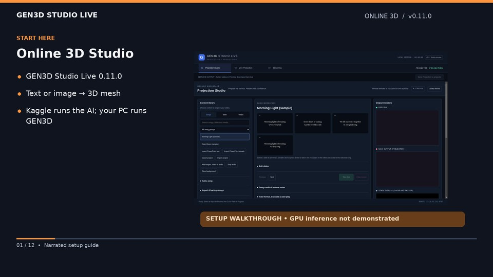

# GEN3D Online 3D Studio — narrated setup guide

For actual screen footage with mouse clicks and typing, see the [real desktop walkthrough](../real-desktop/README.md). This earlier guide uses narrated screenshots.

[](https://github.com/praisecyber/GEN3D-STUDIO-LIVE/releases/download/v0.11.0/GEN3D-Online-3D-Studio-Tutorial.mp4)

[Watch/download MP4](https://github.com/praisecyber/GEN3D-STUDIO-LIVE/releases/download/v0.11.0/GEN3D-Online-3D-Studio-Tutorial.mp4) · [English captions (SRT)](https://github.com/praisecyber/GEN3D-STUDIO-LIVE/releases/download/v0.11.0/GEN3D-Online-3D-Studio-Tutorial.srt) · [Full setup guide](../../HUNYUAN3D-ONLINE.md)

A roughly four-minute 1080p walkthrough with English synthetic narration and burned-in captions. It covers downloading GEN3D 0.11.0 and the notebook, Kaggle GPU/Internet/Secrets setup, the running server cell, connecting the desktop, text/image inputs, review, GLB export, explicit projection, cancellation and session reconnection.

The screenshots are from the real GEN3D app. Kaggle setup is shown as instruction cards, not a recording of the Kaggle website. Connected/preview scenes use a clearly labelled procedural sample robot and a tutorial-only local backend. The sample is **not** Hunyuan output and does not establish successful GPU inference. Actual Kaggle generation, dependency compatibility and GPU memory fit remain unverified. No real GPU token is displayed. The app's unrelated temporary phone PIN is redacted during capture. Free Kaggle GPU sessions are temporary and quota-controlled.

## Chapters

- 00:00 — Online 3D Studio
- 00:16 — Download both files
- 00:31 — Prepare Kaggle
- 00:52 — Keep your token private
- 01:10 — Run the notebook
- 01:30 — Connect GEN3D
- 01:48 — Create from text
- 02:07 — Create from an image
- 02:27 — Review before going live
- 02:45 — Save or use the model
- 03:04 — Cancel and reconnect
- 03:23 — What is verified?

## Narration transcript

### Online 3D Studio

Welcome to Gen three D Studio Live. This guide shows how to set up online three D generation using your own Kaggle GPU session. The app screens are real. The preview model is an illustrative sample, not proof of a successful live Hunyuan generation.

### Download both files

Open the version zero point eleven release on GitHub. Download the Windows installer and the Kaggle notebook. Run the installer on your PC. If you choose the zip instead, extract it first. This is an unsigned development preview.

### Prepare Kaggle

In your Kaggle account, create a notebook and import the downloaded notebook file. Select a CUDA GPU accelerator, and enable Internet. GPU access may require account verification. Availability, quotas, and session time limits are controlled by Kaggle. Free GPU access is not permanent hosting.

### Keep your token private

Open Kaggle's Secrets interface, usually under Add ons. Create the secret named on screen, using a unique random value of at least thirty two characters. Enable it for this notebook. Keep the same value securely for the desktop app. Never paste it into a public notebook cell or GitHub.

### Run the notebook

Run the setup cell and enter the full legal name of the person or organization operating your GPU service. Then run the server cell and leave it running. Setup checks CUDA and dependencies. Copy the H T T P S connection URL it prints. The first generation downloads model weights and may take several minutes.

### Connect GEN3D

In Gen three D, open Projection Studio and expand Online three D Studio, Hunyuan three D. Paste the connection URL printed by your own running notebook. Enter the same private token and choose Connect GPU. The token field clears after submission. Do not use somebody else's URL or token.

### Create from text

For text, choose Text description. Describe one complete object, such as a friendly orange robot on a plain background. Start with thirty shape steps and seed zero, then choose Generate three D model. The backend first creates a reference image with S D X L Turbo, then builds a Hunyuan mesh.

### Create from an image

For image input, choose Reference image, then choose a P N G or J peg file. Use one clearly visible subject with as little background clutter as possible. The file limit is ten megabytes and sixteen megapixels. Choose Generate three D model after selecting your image. Wait for the GPU job to finish.

### Review before going live

When a job succeeds, the model downloads into your local library. Review it in the preview before using it. This video uses a procedural sample robot to explain the controls. It is not Hunyuan output. Generating and previewing a model do not change your live projection.

### Save or use the model

Choose Save G L B copy to export the model to a folder. Choose Use reviewed model on projection only when you are ready to show it. That explicit action changes projection. The sample on screen demonstrates this control. Generated meshes are not automatically rigged, animated, or able to sing.

### Cancel and reconnect

Use Cancel if you no longer need a job. A GPU operation already running may finish before cancellation can discard its result. If Kaggle stops or restarts, run the notebook again and reconnect using its new URL. Models already downloaded remain on your PC and can be reviewed offline.

### What is verified?

If connection fails, check the URL, token, Internet access, and running server cell. If generation fails, inspect the G P U log in Kaggle. This profile creates untextured, unrigged meshes. Automated app and service tests passed, but actual inference on Kaggle hardware remains unverified. Use the linked setup guide for details.

## Reproduce the video

Use the repository's installed Electron/Playwright/Three dependencies, Xvfb, Python with Pillow, DejaVu fonts, and FFmpeg/FFprobe with libflite, libx264 and libass. From the repository root:

```bash
DISPLAY=:99 bash scripts/start-cloud-display.sh
DISPLAY=:99 node docs/tutorials/online-3d/source/capture.cjs
python3 docs/tutorials/online-3d/source/render.py
```

`GEN3D_TUTORIAL_WORK` can override the temporary rendering directory. The renderer creates its synthetic English narration locally; no external voice service, music, private token or paid GPU is used. `video.json` contains chapter timing and SHA-256 checksums. The GitHub tutorial workflow checks those hashes before attaching the MP4 and captions to release v0.11.0. This workflow does not rebuild or alter the app installer.
